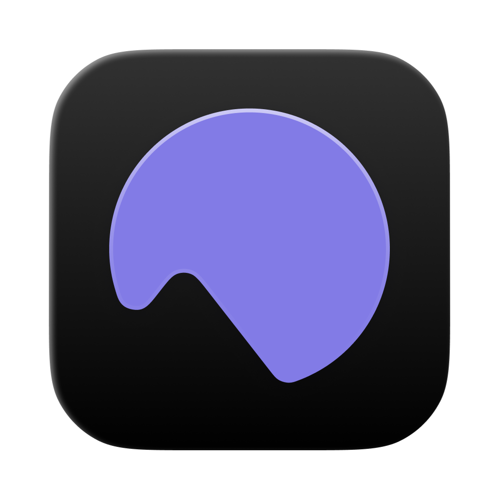
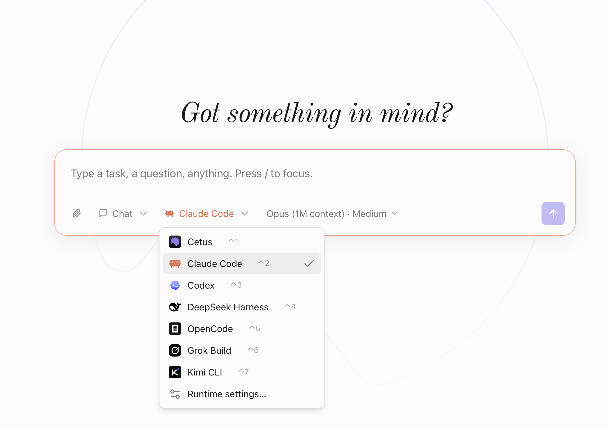
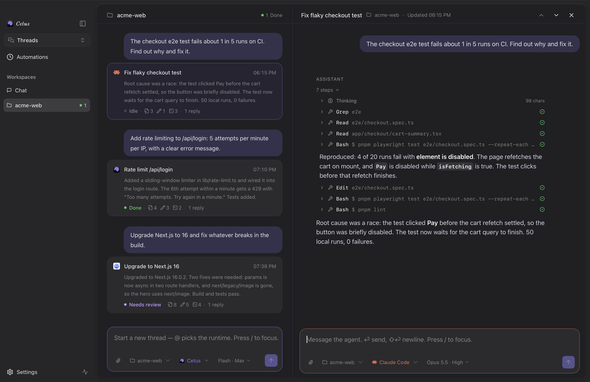
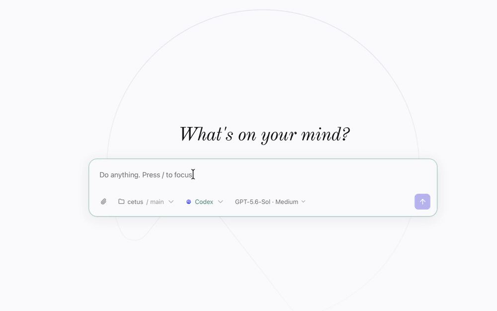

<h1 align="center">Human in the loop is the bottleneck.</h1>

<strong>Cetus</strong> is a desktop client for reviewing and managing the work of every agent you run — Claude Code, Codex, DeepSeek Harness, OpenCode, Grok Build, Kimi CLI, or the built-in runtime.

<a href="https://cetus.run">Official website · cetus.run</a>

  
  

  
  
  
  
  

<strong>English</strong> · <a href="./README.zh-CN.md">简体中文</a>

## Community

⭐️ Star the repo to get notified about new releases. To share feedback, scan the QR code with WeChat to join the group chat.

Friendly links

- [LINUX DO](https://linux.do) — A community of idealists.

## Why Cetus

Agents are no longer the slow part. Claude Code, Codex, and DeepSeek Harness can work for an hour on their own. What slows them down is the person they are waiting on: a permission prompt, a clarifying question, a finished task that nobody has reviewed yet.

And that person is usually juggling several products. Claude Code in one window, Codex in another, scheduled jobs that each report back in a different client. Every switch costs attention, and every minute you don't notice an agent waiting is a minute it sits idle.

Some tools, like Superset, put different runtimes side by side, but in a TUI. A terminal is a fine place for an agent to run and a poor place for a person to read: everything is monospaced text, plans, diffs, and questions all look alike, and whatever scrolls off is gone.

Cetus is built for the human side of the loop: a real desktop app where every agent's work is easy to read, easy to answer, and easy to review.

## One client for every runtime

- **Every runtime in one window.** Use the CLI you already have installed and signed in to. Cetus reuses its login, model, and tools, so there is no second account to set up.
- **One place to respond.** Permission prompts, questions, and plans from any runtime show up as cards in the conversation. Steer a running turn or queue the next message without waiting for it to finish.
- **One board for review.** Every conversation is a card in **In progress · Needs review · Done**. Finished work waits for you instead of scrolling away in a terminal.
- **Parallel without collisions.** Per-conversation git worktrees let several agents edit the same repo at once.

## Built around the same loop

Everything else in Cetus exists to make your part of the loop shorter.

### Threads — see all your sessions at once

A workspace feed where every message starts its own session, on whichever runtime you `@mention`. Open any thread docked beside the feed, and follow the activity badges to the next session that needs you.

### Quick Launcher — any runtime, one hotkey away

Hold **both ⌘ keys** to summon an agent over any app. Cetus brings along the current screenshot, frontmost app, browser URL, and selected text as removable context chips, so you can ask in place instead of switching windows and explaining what you are looking at.

### Automations — scheduled work lands in the same place

Turn any prompt into a one-off or recurring job (`at` / `every` / `cron` / `daily`) on any runtime. Each run works in a fresh background conversation and lands on the board for review, instead of reporting back in yet another client.

### Less explaining

The less context you have to type, the faster you get back out of the loop.

- **Screen context.** Cetus captures frames, dedupes them, and OCRs them on-device with Apple Vision, so the agent can recall what was on screen. Opt-in, with retention controls and an excluded-apps list.
- **Meeting memory.** Calls are transcribed on-device into searchable notes — text only, no audio stored. Ask "what did we decide about the launch date?" and the agent searches your meetings locally. Off by default.
- **Dictation.** Hold a hotkey in any app and talk; Cetus types the cleaned-up text wherever your cursor is.
- **Persistent memory** that you and the agent both edit, carried into future conversations.

### And more

- **Parallel solutions**: fan one prompt into N candidate runs, keep one, archive the rest
- **Cetus Remote**, an optional Tailscale-backed phone companion for following runs and handling approvals away from your desk
- **Computer and browser control**, with a confirmation step before anything consequential and a Stop button always in reach
- **30+ model providers** for the built-in runtime, including Anthropic, OpenAI, Google, Bedrock, Ollama, LM Studio, and OpenRouter

Every capability that touches your screen, mic, or apps is opt-in, and everything stays on your Mac.

## Get started

Cetus runs on **Apple Silicon** Macs. There are two builds of the same app:

| Build | Download | Requires |
| --- | --- | --- |
| **Cetus** — the original app, built with Tauri | [Cetus.dmg](https://github.com/drewnekota/cetus/releases/latest/download/Cetus.dmg) | macOS 13+ |
| **Cetus Swift** (Beta) — a native SwiftUI build, still missing some polish | [Cetus-Swift.dmg](https://github.com/drewnekota/cetus/releases/download/swift/Cetus-Swift.dmg) | macOS 15+ |

Both update themselves. Then:

1. Open the DMG and move Cetus to Applications.
2. Use the built-in runtime, or pick an installed and signed-in `claude`, `codex`, or `dsh` (DeepSeek Harness) CLI.
3. Choose a workspace and give the agent its first task.

> **Early release:** Cetus is under active development. Please [open an issue](https://github.com/drewnekota/cetus/issues) if something breaks or a workflow is missing.

## License

MIT
