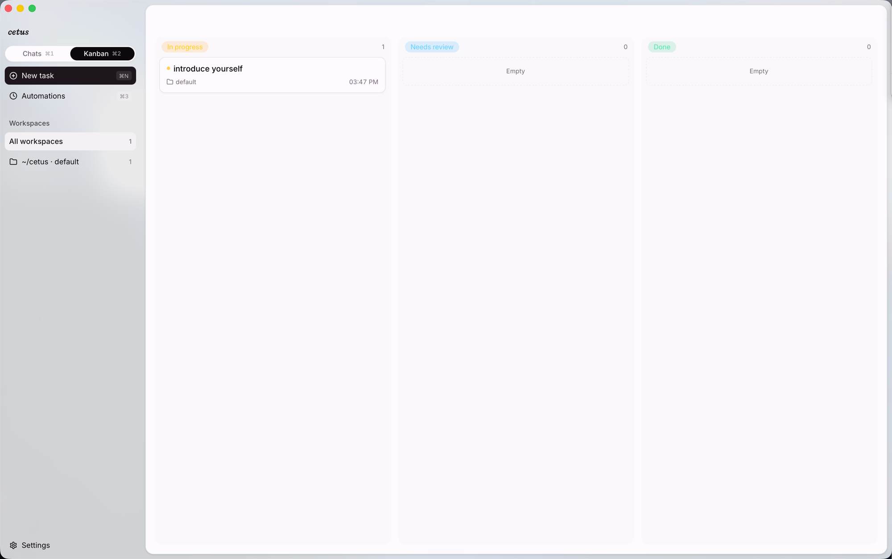
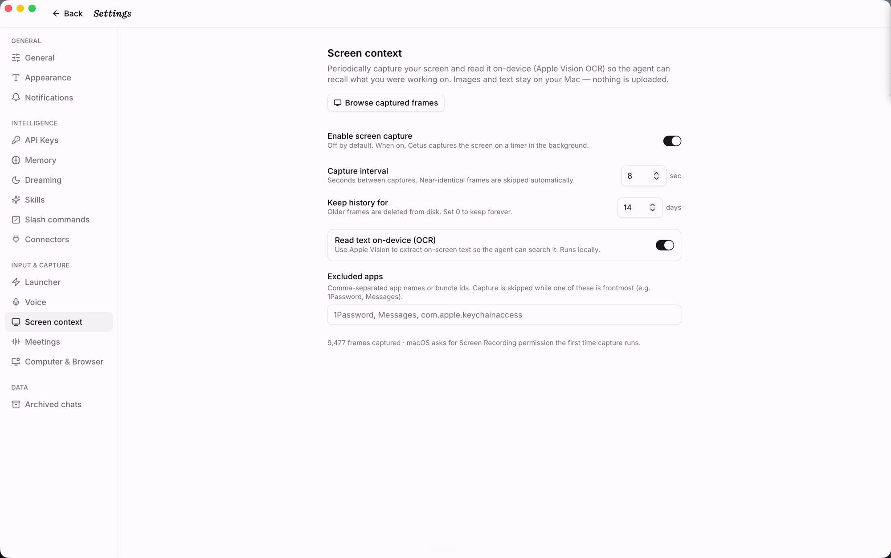
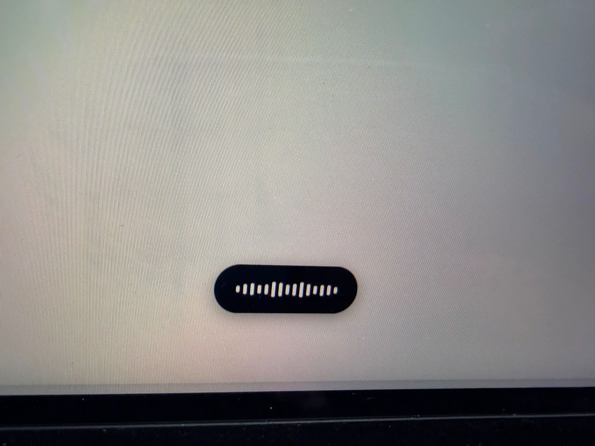
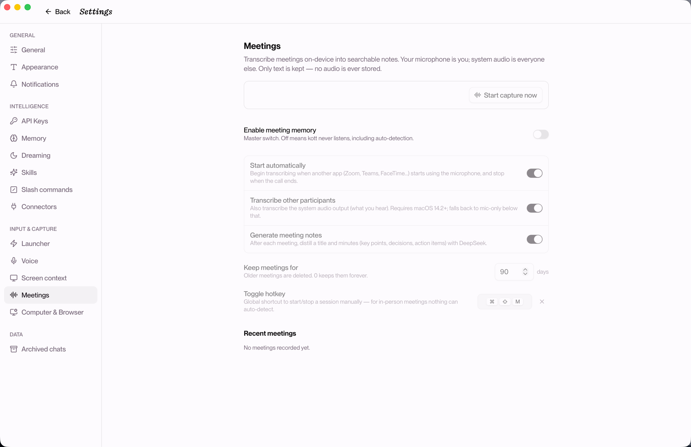

<p align="center"></p>

<h1 align="center">Cetus</h1>

<p align="center"><a href="https://cetus.run">官方网站 · cetus.run</a></p>

<p align="center"><strong>一个桌面客户端，管好你在用的所有 agent。</strong></p>

<p align="center">Claude Code、Codex、DeepSeek Harness、OpenCode、Grok Build、Kimi CLI，或内置 runtime —— 都在同一个 Mac app 里，在同一个地方批准、回答、审阅它们做的事。</p>

<p align="center">
  <a href="https://github.com/drewnekota/cetus/releases/latest/download/Cetus.dmg"></a>
  <a href="https://github.com/drewnekota/cetus/releases/download/swift/Cetus-Swift.dmg"></a>
</p>

<p align="center">
  <a href="https://github.com/drewnekota/cetus/releases/latest"></a>
  <a href="https://github.com/drewnekota/cetus/releases"></a>
  <a href="https://github.com/drewnekota/cetus/actions/workflows/ci.yml"></a>
  <a href="https://github.com/drewnekota/cetus/stargazers"></a>
  <a href="LICENSE"></a>
</p>

<p align="center"><a href="./README.md">English</a> · <strong>简体中文</strong></p>


## 为什么做 Cetus

coding agent 已经不是慢的那一环了。Claude Code、Codex、DeepSeek Harness 都能自己连续干一个小时。真正拖慢进度的是 **human in the loop**：agent 停下来要权限、问一个澄清问题、或者做完了等你审阅 —— 而你根本没注意到，因为它躲在十几个终端标签页里的某一个。

认真用 agent 的人，基本都不止用一个：这个任务用 Codex，那个用 Claude Code，再换个模型听听第二意见。每个 runtime 都有自己的终端、自己的审批提示、自己表达"我做完了"的方式。agent 开得越多，你一天里花在切标签页上的时间就越多，agent 等你的时间也越多。

所以 Cetus 做的第一件事，是给它们一个统一的客户端：

- **所有 runtime 在一个窗口里。** 直接用你已经装好、登录好的 CLI。Cetus 复用它的登录、模型和工具，不用再配第二个账号。
- **在一个地方响应。** 任何 runtime 的权限请求、提问和计划，都以卡片形式出现在对话里。turn 还在跑也能插话引导，或者把下一条消息排进队列。
- **在一块看板上审阅。** 每个对话都是 **进行中 · 待审阅 · 已完成** 里的一张卡片。做完的工作会等着你，不会在终端里被滚走。
- **并行但不打架。** 每个对话可以有独立的 git worktree，多个 agent 能同时改同一个仓库。



当你所有的 agent 都跑在一个客户端里，它自然就成了承载周边一切的地方。Cetus 的其它能力都是从这里长出来的。


## 立即使用

Cetus 支持 **Apple Silicon** Mac，同一个 app 有两个版本：

| 版本 | 下载 | 系统要求 |
| --- | --- | --- |
| **Cetus** —— 最早的版本，基于 Tauri | [Cetus.dmg](https://github.com/drewnekota/cetus/releases/latest/download/Cetus.dmg) | macOS 13+ |
| **Cetus Swift** —— 原生 SwiftUI 版本 | [Cetus-Swift.dmg](https://github.com/drewnekota/cetus/releases/download/swift/Cetus-Swift.dmg) | macOS 15+ |

两个版本都会自动更新。然后：

1. 打开 DMG，把 Cetus 拖进「应用程序」。
2. 使用内置 runtime，或选择一个已安装并登录的 `claude`、`codex` 或 `dsh`（DeepSeek Harness）CLI。
3. 选一个工作区，给 agent 布置第一个任务。

> **早期版本：** Cetus 仍在快速迭代中。遇到问题或缺少某个工作流，欢迎[提 issue](https://github.com/drewnekota/cetus/issues)。

## 从这里长出来的能力

### Quick Launcher：一个快捷键，随时叫出 agent

**同时按住左右 ⌘**，即可在任意 app 之上唤出 agent。Cetus 会把当前截图、前台 app、浏览器 URL 和选中文字作为可移除的 context 一起带进来，让你就地提问，不必先解释自己正在看什么。


### Automations：你不在时，也让它继续工作

把任意 prompt 变成单次或周期任务（`at` / `every` / `cron` / `daily`）。每次运行都保留所选 runtime 和模型设置，在新的后台对话中完成，结果落到看板上等你审阅。


### Screen Context：让它记得你之前在做什么

开启屏幕上下文后，Cetus 会采集画面、去重，并用 Apple Vision 在本地做 OCR。agent 之后可以回忆屏幕上出现过什么，或按文字和 app 检索历史。所有数据都留在你的 Mac 上；采集需要手动开启，并提供保留时长设置和排除 app 列表。



### 在任意 app 中听写

在任何地方按住快捷键说话。Cetus 会弹出一个小的均衡器 HUD，用 Seed-ASR 转写，再把整理好的文字输入到光标所在位置。



### 把会议变成可搜索的上下文

开启 **meeting memory** 后，Cetus 会在本地把通话转写成可搜索的笔记 —— 只存文字，不存音频。当其它 app 占用麦克风（Zoom、Teams、FaceTime、飞书……）时自动开始，也可以用快捷键（默认 **⌘⇧M**）手动开始；麦克风和系统音频分开采集，转写能分清谁说了什么。问一句"发布日期最后怎么定的？"，agent 就会在本地检索会议历史。默认关闭。



### 还有更多

- **持久记忆**：你和 agent 都能编辑，会带进之后的对话
- **并行方案**：一个 prompt 分出 N 个候选运行，留一个、归档其余
- **Cetus Remote**：可选的手机端伴侣（基于 Tailscale），随时跟进运行、处理审批
- **电脑与浏览器控制**：执行任何关键操作前都会确认，停止按钮始终可用
- 内置 runtime 支持 **30+ 模型供应商**，包括 Anthropic、OpenAI、Google、Bedrock、Ollama、LM Studio 和 OpenRouter

所有涉及屏幕、麦克风或其它 app 的能力都需要你手动开启。

## 社区

⭐️ 给仓库点个 Star，第一时间收到新版本通知。想交流使用体验和建议，欢迎微信扫码加入群聊。

<p align="center"></p>

## 参与开发

### 环境要求

- **Node** ≥ 20、**pnpm**、**bun**（用于构建 pi sidecar 二进制）
- **Rust** stable（`rustc`、`cargo`）
- **Tauri** 前置依赖：<https://v2.tauri.app/start/prerequisites/>
- 一个 **`DEEPSEEK_API_KEY`**（或你选用的供应商；pi 会自动读取 `ANTHROPIC_API_KEY`、`OPENAI_API_KEY` 等）
- **可选**：本机安装并登录过 **Claude Code**（`claude`）、**Codex**（`codex`）和/或 **DeepSeek Harness**（`dsh`）CLI，即可把它们用作对话 runtime —— Cetus 复用其现有登录，无需额外配置

### 首次配置

```bash
pnpm install
# 把 pi 构建为单文件二进制，输出到 src-tauri/binaries/pi-<target>。
# 约 30 秒。每台开发机跑一次即可；二进制已被 gitignore。
./scripts/build-pi-sidecar.sh
```

### 开发运行

```bash
export DEEPSEEK_API_KEY=sk-...
pnpm tauri dev
```

Tauri 会启动 Next.js 开发服务器（端口 17381）并打开一个指向它的窗口。pi sidecar 会从打包好的二进制自动派生。

#### 开发后门：`PI_BIN`

如果你在迭代 pi 本身，可以指向任意 pi 构建来绕过 sidecar：

```bash
export PI_BIN=/absolute/path/to/your/pi
pnpm tauri dev
```

这会完全跳过 `tauri-plugin-shell`，改用原始的 `tokio::process::Command`。

### 构建

```bash
./scripts/build-pi-sidecar.sh   # 如果还没跑过
pnpm tauri build
```

在 macOS 上输出 `.app` / `.dmg`。`tauri build` 需要一套完整的多尺寸图标（存于 `src-tauri/icons/`，用 `pnpm tauri icon <path-to-1024px.png>` 重新生成）。

### Cetus Swift

原生版本在 [`swift/`](swift) 目录下，是一个 SwiftPM 包（macOS 15+）。`swift build` 编译；`swift/bundle.sh` 会组装出 `swift/build/Cetus.app`，需要通过 `$CETUS_AGENTD` 指定 `cetus-agentd` 二进制。

## 架构

```
┌──────────────────────────────── Tauri window ──────────────────────────────────┐
│                                                                                │
│  Next.js (static export)              Rust (Tokio + tauri-plugin-shell)        │
│  ┌─────────────────────────┐          ┌──────────────────────────────────────┐ │
│  │ React UI                │  invoke  │  Tauri commands                      │ │
│  │ - ConversationList      │ ───────► │  (list, new, switch, send,           │ │
│  │ - Chat (text/thinking/  │          │   archive, set_model,                │ │
│  │   tool cards), Composer │ ◄─────── │   extension_ui_respond, …)           │ │
│  │ - ModelPicker           │  event   │                                      │ │
│  │ - DialogHost (ext UI)   │          │  PiRpc: sidecar(plugin-shell) OR     │ │
│  │ - chatReducer (deltas → │          │    PI_BIN(tokio::process)            │ │
│  │   RenderedMessage[])    │          │  Store: SQLite metadata              │ │
│  └─────────────────────────┘          └─────────────────┬────────────────────┘ │
│                                                         │ stdin/stdout         │
│                                                         ▼ (LF-framed JSON)     │
│                                       ┌──────────────────────────────────────┐ │
│                                       │  pi --mode rpc subprocess            │ │
│                                       │  (bundled binary, any-model engine)  │ │
│                                       └──────────────────────────────────────┘ │
└────────────────────────────────────────────────────────────────────────────────┘
```

- **对话** 是 `<app-data>/sessions/` 下的 pi `.jsonl` session 文件。我们在 `<app-data>/cetus.db` 的 SQLite 里为它们建索引（id、title、session_file、model、时间戳、archived_at）。
- **切换**：`switch_session` + `get_messages` 重放历史。整个 app 生命周期里只有一个 pi 进程。
- **流式**：pi 发出 `agent_start`、带 `assistantMessageEvent` 增量的 `message_update`，以及 `tool_execution_*` 事件。前端的 `chatReducer` 把这些折叠成按 `contentIndex` 索引的稳定 `RenderedMessage[]`，并用一张 `toolCallId → block` 旁表来路由执行更新。
- **分帧**：严格 LF 的 JSONL。`tauri-plugin-shell` 以任意字节块投递 stdout，所以读取端维护自己的累加缓冲，按每个 `\n` 吐出一行，并剥掉可选的 `\r`。按 Unicode 分隔符切分的通用行读取器（Node `readline`）不符合规范。
- **Sidecar 打包**：`src-tauri/binaries/pi-<target>` 打进 `.app/Contents/Resources/`。`PI_BIN` 环境变量是迭代 pi 的开发后门。
- **CLI runtime**：跑在 **Claude Code** / **Codex** / **DeepSeek Harness** 上的对话完全绕过 pi RPC —— `cetus-bridge::cli_agent` 为每个对话保持 Claude（或 DeepSeek Harness）streaming session 或 Codex app-server thread，由带单测的 `EventTranslator` 把事件翻译成 `chatReducer` 已经在消费的 PiEvent 流。上下文与后台终端通过 vendor session/thread 跨轮延续；可选的 per-conversation git worktree 用于隔离改动。
- **Extension UI**：当某个 pi extension 调用 `ctx.ui.select()` 等，pi 会通过事件流发出 `extension_ui_request`。前端 `DialogHost` 渲染一个对话框，并通过 `extension_ui_respond` Tauri 命令回复。

## 可复用的 bridge 包

host/extension bridge 被拆成了两个独立、与具体 provider 无关的包，可以单独依赖，无需引入整个 app：

- **[`cetus-bridge`](src-tauri/cetus-bridge)**（Rust crate）—— 产品无关的 host 运行时：围绕 `pi --mode rpc` 的 JSONL 子进程 RPC、确定性的 extension 加载、host tunnel 分类，以及可注入的 `EventSink` / `TaskSpawner` trait。Tauri、app 存储、模型 provider 选择都留在 crate 之外，由 app 侧适配器承接（`tauri_bridge.rs`、`app_event.rs`、`model_bridge.rs`）。`examples/minimal_host.rs` 给出了最小集成示例。
- **[`@cetus/bridge-protocol`](packages/cetus-bridge-protocol)**（TypeScript）—— extension 侧协议：共享的 `HOST_TUNNELS` 哨兵列表、`callHost()`、`toolResult()`，以及 host tunnel 的类型定义。

两个包都是 MIT 协议，且不含任何 Cetus / DeepSeek 专属代码，其他 agent host 也可以复用同一套 bridge。

<details>
<summary>友情链接</summary>

- [LINUX DO](https://linux.do) —— 有理想的新社区。

</details>

## 许可证

MIT（与 pi 一致）。
